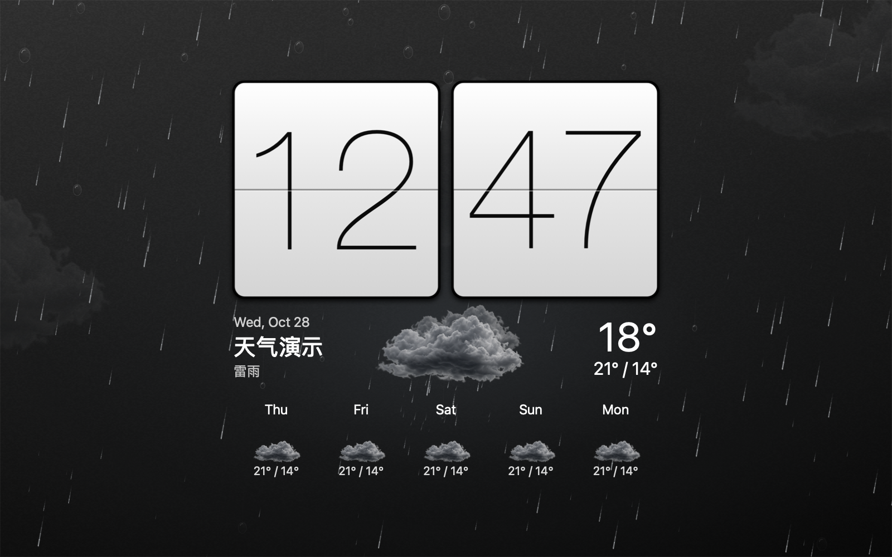

# SenseClock

A native macOS screen saver inspired by the classic HTC Sense flip clock. Built with Swift, AppKit, and ScreenSaver, with no third-party code dependencies. Online weather support arrived in version 1.1. Version 1.1.1 fixed an issue that prevented the Options window from opening and closing in System Settings.



## Installation and setup

Build the project first using the instructions below to create `build/SenseClock.zip`.

1. Extract `build/SenseClock.zip`, double-click `SenseClock.saver`, and follow the macOS prompt to install it for your user. Choose Replace if an older version is installed.
2. In System Settings, open Wallpaper → Screen Saver, choose Custom, scroll to Other, and click Show All. Select **SenseClock** and open Options.
3. Enter a city in Weather City, search, select the matching city, region, and country from the results, then click Save. The default city is Cupertino; the app does not determine your location automatically.

Chinese and English city names are supported. Try `Beijing`, `Shanghai`, or `Paris, France`; region and country details distinguish cities with the same name. Typing without searching and selecting a result does not change the saved city. You can choose °C or °F, switch between 12-hour and 24-hour time, adjust the clock and weather size, and disable weather or the anti-burn-in shift.

The bundled `SenseClock Preview.app` provides a standalone preview: press `⌘D` to demonstrate a flip, `⌘,` to open settings, `⌘F` to toggle full screen, and `⌘Q` to quit. macOS controls when the screen saver exits.

The options window was verified in System Settings on this Mac, including opening, reopening, saving, and canceling. Its panel can receive keyboard focus in the screen saver host and closes the settings session through the ScreenSaver API.

## Languages (1.6.0)

The screen saver and preview app support English, Simplified Chinese, and Traditional Chinese. The default is **Follow System**, which selects the first supported language in macOS Preferred Languages and falls back to English when none match. Open Options → Language to override it. Dates, weekdays, weather descriptions, settings, demo controls, and menus use the selected language. Saved city names retain the provider's original spelling; new city searches request localized results where Open-Meteo supports them.

Translation catalogs live in `Assets/Localizations/<language>.lproj/Localizable.strings` and are bundled with both products. Source code comments and project documentation remain in English.

## Full-screen weather background (1.5.1)

The weather animation and background fill the display. The clock, current conditions, and five-day forecast stay centered at a moderate size. The background and foreground use independent scales, so changing **Clock and Weather Size** does not shrink the rain, clouds, snow, or lightning. The component has no separate square background panel.

The size slider is always available and preserves glyph proportions. Text stays aligned to physical pixels. The optional anti-burn-in shift affects only the foreground and moves it once every five minutes.

In the preview app, `⌘F` enters full screen and hides the demo controls until full screen ends. Weather modes remain available through `⌘0`–`⌘9`. You can also launch a full-screen preview with `--fullscreen`.

## Photorealistic weather animation and demos

Generated transparent cloud and moon imagery is combined with subdued lighting, slow cloud motion, light rain, varied snowfall, low fog, and brief cloud-to-cloud lightning. Clear weather uses soft sunlight; clear nights show a moon and a few dim stars. The design avoids cartoon sun rays, neon rain, oversized hexagonal snowflakes, and decorative auroras.

In storms, the main lightning bolt extends from near the top to near the bottom of the display, with branches spanning a broad area. The clock cards are drawn above the lightning to keep the digits readable. Each strike uses a varied, subdivided branch pattern and several brief return strokes. Clouds and nearby air respond to the flash. Raindrop speed, size, opacity, and trail length vary with distance; transparent glass droplets and sliding water trails add a foreground layer.

Three generated images live in `Assets/Weather/`. The built-in image generation tool created them; the full prompts are in [Assets/Weather/PROMPTS.md](Assets/Weather/PROMPTS.md). These visual assets are not live photographs. The moon phase is illustrative and does not track the current lunar phase. All images are bundled with the saver and preview; no image server is contacted at runtime.

Open `build/SenseClock Preview.app` and use the buttons along the bottom to select Live, Clear, Partly Cloudy, Cloudy, Rain, Snow, Fog, Storm, or Clear Night. Auto Tour changes the demo every six seconds. Press `⌘0` for live weather, `⌘1`–`⌘8` to select a demo, or `⌘9` to toggle the tour. Demo mode appears in the window title and city label; it does not save simulated weather or change the selected city.

Version 1.4.3 fixed text jitter caused by continuous movement of the clock group. The preview now stays fixed and aligns the layout to physical pixels. The screen saver retains an optional anti-burn-in shift that moves the foreground only once every five minutes.

Weather animation can be disabled in screen saver options. The app also follows the system Reduce Motion setting. Background effects are drawn behind the clock cards. The update, cache, and demo status line at the bottom of the main view remains removed.

Export an animated comparison of the eight weather modes:

```sh
"build/SenseClock Preview.app/Contents/MacOS/SenseClockPreview" --export-weather "$PWD/build/weather-showcase.gif"
```

Open the rotating preview directly:

```sh
open "build/SenseClock Preview.app" --args --showcase
```

## Live weather

- Uses the [Open-Meteo Weather API](https://open-meteo.com/en/docs) and [Geocoding API](https://open-meteo.com/en/docs/geocoding-api). No API key is required. The public endpoint is intended for non-commercial use; commercial distribution should use a suitable [Open-Meteo service plan](https://open-meteo.com/en/pricing).
- Displays the selected city's current temperature and conditions, today's high and low, and a five-day forecast. Current conditions are provider model data, not a local sensor reading.
- Refreshes every 30 minutes, uses a 15-second request timeout, and retries failures every five minutes. The saver checks for updates while it runs and does not poll after it exits.
- Caches the last successful response. The preview and screen saver share preferences and cache. Cached data remains available offline. If the first request fails, the display shows “Weather unavailable” with placeholders, without update or cache status text.
- Data for a previous city is not reused after a city change. Expired forecast days are filtered using the city's local date. Forecasts use the city's time zone; the main clock and date always use the Mac's local time zone.
- Icons distinguish clear, partly cloudy, cloudy, rainy, snowy, foggy, and stormy weather. Clear and partly cloudy icons support day and night variants.
- The app does not request location permission. City search sends the search term to Open-Meteo's geocoding endpoint. Weather updates send the selected city's coordinates to the forecast endpoint.

Weather data is provided by [Open-Meteo](https://open-meteo.com/), and city data comes from [GeoNames](https://www.geonames.org/). The data is licensed under [CC BY 4.0](https://creativecommons.org/licenses/by/4.0/); see the [provider's license information](https://open-meteo.com/en/licence). The app maps weather codes to labels and custom icons, rounds displayed temperatures, and can convert them to Fahrenheit.

## Build and verification

Requires macOS and Xcode or the Xcode Command Line Tools:

```sh
bash scripts/build.sh
bash scripts/check.sh
```

`check.sh` covers time boundaries, weather parsing, missing values, malformed responses, time zones, unit conversion, caching, refresh throttling, offline fallback, city changes, stale request isolation, universal binary signing, and screen saver loading. It also checks animation frames for all eight weather modes, deterministic frame rendering, and clock-card visibility. Plugin and graphics checks require a macOS environment that can run native GUI applications.

Optionally test the live weather endpoints:

```sh
build/WeatherTests --live
```

Create a screenshot with live weather (this contacts the service and updates the weather cache):

```sh
"build/SenseClock Preview.app/Contents/MacOS/SenseClockPreview" --live-snapshot "$PWD/build/live-preview.png"
```

Builds include Apple Silicon and Intel architectures and target macOS 12 or later. Bundles are locally ad hoc signed and verified, but are not notarized by Apple. External distribution requires Developer ID signing and notarization. The ZIP is created from a clean temporary copy to avoid Finder metadata in cloud-managed folders interfering with the signature. The project does not install the screen saver or change System Settings automatically.

`Sources/SenseClockView.swift` implements the interface, flip animation, screen saver lifecycle, and settings. `ClockModel.swift` contains time and preference logic. `Weather.swift` handles weather requests, caching, and refreshes. `PreviewApp.swift` provides the standalone preview and animation export. `WeatherEffects.swift` draws weather effects and demo states. Cloud and moon imagery was generated for this project; other effects are drawn by the app. The project does not include HTC's original assets or logo.
